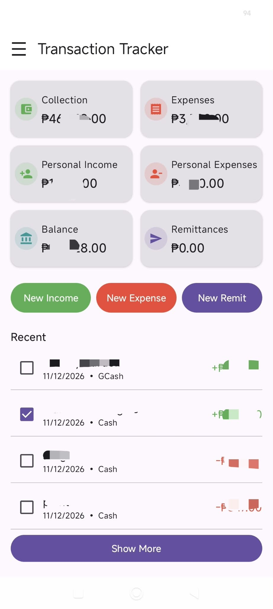
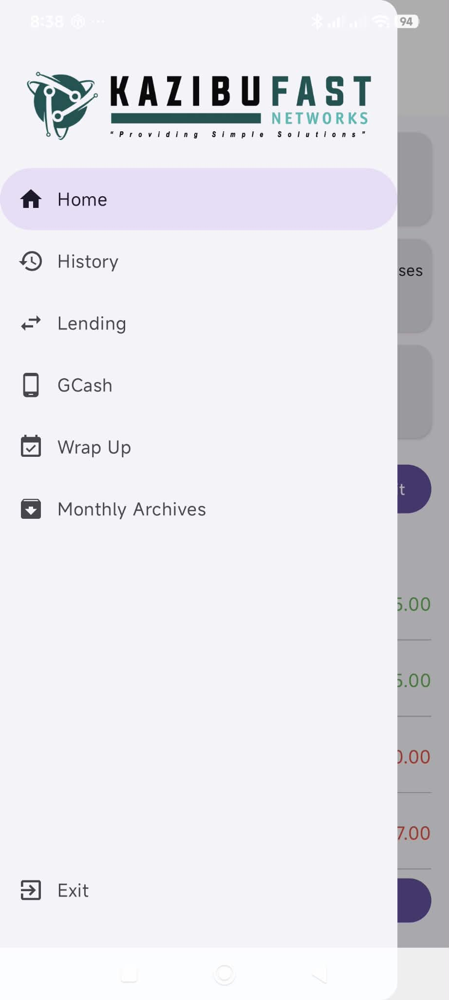
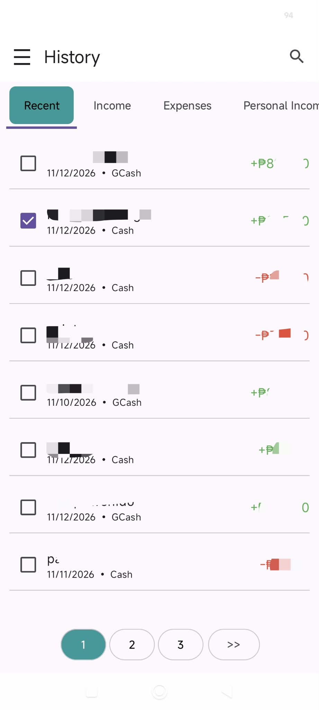
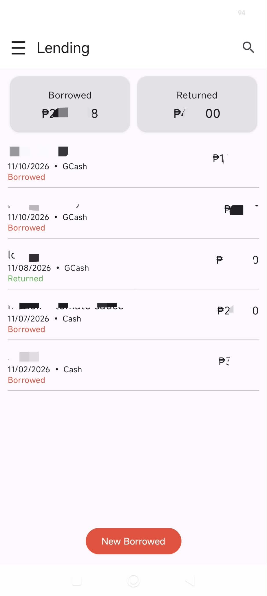
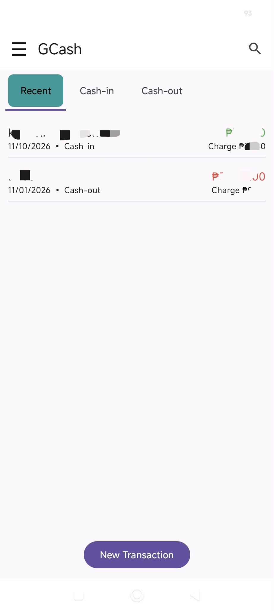
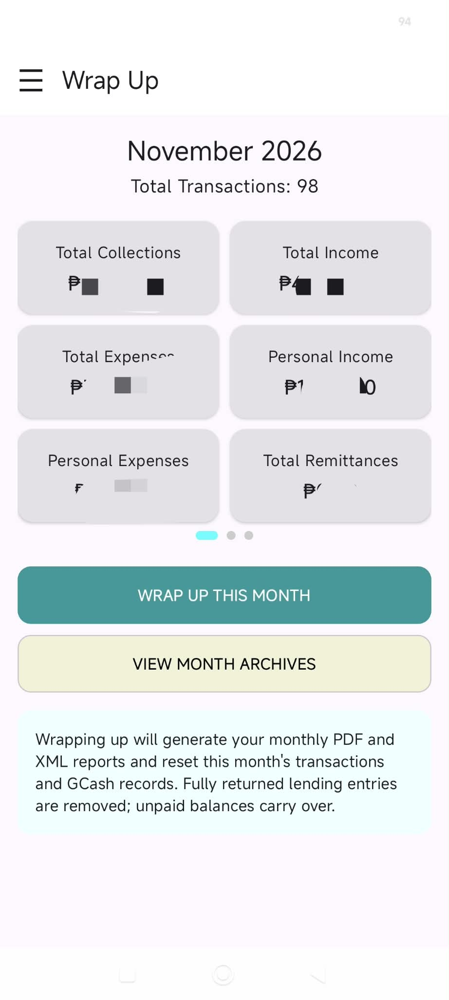
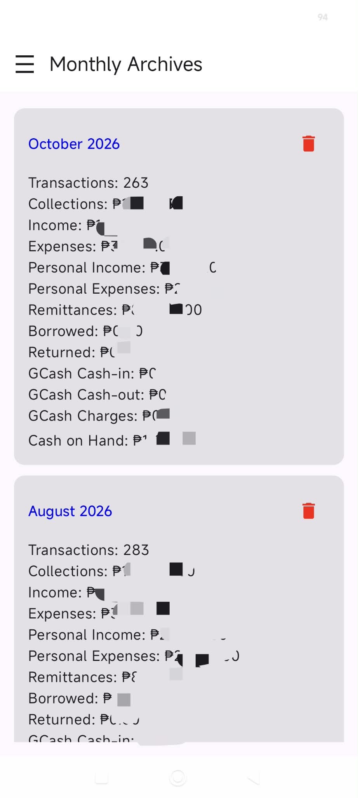
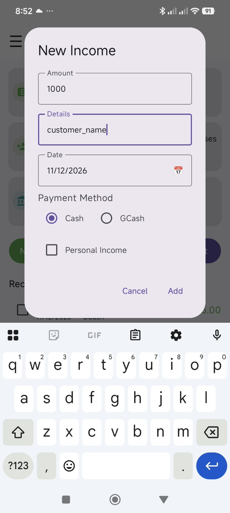

# Transaction Tracker

An offline Android app for tracking income, expenses and other money movements for a partnership business and a personal part-time income. All data is stored on the device, with no account or internet connection needed.

Built with Kotlin, Jetpack Compose (Material 3) and Room.

## Screenshots

<table>
  <tr>
    <td align="center"><br><b>Home</b></td>
    <td align="center"><br><b>Menu</b></td>
    <td align="center"><br><b>History</b></td>
  </tr>
  <tr>
    <td align="center"><br><b>Lending</b></td>
    <td align="center"><br><b>GCash</b></td>
    <td align="center"><br><b>Wrap Up</b></td>
  </tr>
  <tr>
    <td align="center"><br><b>Monthly Archives</b></td>
    <td align="center"><br><b>New Income</b></td>
    <td></td>
  </tr>
</table>

## Features

- **Home dashboard** with cards for Collection, Expenses, Personal Income, Personal Expenses, Balance and Remittances, plus quick buttons for New Income, New Expense and New Remit. Cards scale their text so they fit smaller screens.
- **History** with tabs (Recent, Income, Expenses, Personal Income, Personal Expense, Remit), search, paging, and a Cash/GCash payment method on every entry. Press and hold a row to Edit or Delete.
- **Lending** to track money you lend out and get back:
  - Borrowed and Returned cards, with a list of entries marked Borrowed, Incomplete (with the balance left) or Returned.
  - Tap an entry to record a payment, in cash or GCash. Press and hold to Edit or Delete.
- **GCash** to track cash-in and cash-out, with the service charge, in Recent, Cash-in and Cash-out tabs. Press and hold to Edit or Delete.
- **Remittances** to your partner, paid in cash or GCash.
- **Wrap Up** to close a month: shows the monthly summary cards, saves a PDF report and an XML backup to the Downloads folder, stores a record in Monthly Archives, then clears the month.
- **Monthly Archives** to browse the saved summaries of past months.

## How the numbers work

Cash and GCash are both supported on income, expenses, remittances and lending.

**Home**
- Collection: non-personal income, adjusted for GCash charges, cash lending and cash returns, with remittances added back so they never lower it.
- Balance: Collection minus Expenses.

**Wrap Up**
- Total Income: non-personal income entered, cash or GCash.
- Total Collections: (income + personal income + GCash charges) − (expenses + personal expenses).
- Cash on Hand: Total Collections − remittances.
- GCash Income: income received via GCash, company and personal.
- GCash Expenses: expenses paid via GCash, company and personal.
- GCash Balance: GCash Income − GCash Expenses.
- Others: company expenses in the Others category.

**Lending**
- Borrowed is the total lent. Returned payments don't reduce it.
- A cash loan lowers Total Income and a GCash loan lowers GCash Income. A cash return adds back to Total Income and a GCash return to GCash Income.
- On Wrap Up, fully returned entries are removed and unpaid balances carry over to the next month.

**GCash transactions**
- Cash-in and cash-out move money between cash and GCash.
- The charge on each one is added to the income totals as cash.

All the money math lives in `Finance.kt`, so Home, Wrap Up, the PDF and the archives use the same rules.

## Project structure

| File | What it does |
| --- | --- |
| `MainActivity.kt` | App navigation, Home, dialogs, Wrap Up, archives and the PDF/XML export |
| `Finance.kt` | All totals and formulas |
| `Common.kt` | Shared UI: scalable cards, date field, Home action buttons |
| `ActionRow.kt` | Press-and-hold Edit/Delete row used by History-style lists |
| `HistoryScreen.kt`, `TransactionRow.kt`, `EditTransactionDialog.kt` | History list and editing |
| `LendingScreen.kt`, `Lending.kt` | Lending screen, entity and DAO |
| `GcashScreen.kt`, `Gcash.kt` | GCash screen, entity and DAO |
| `Transaction.kt`, `TransactionDao.kt` | Income, expense and remittance records |
| `MonthlyArchive.kt`, `MonthlyArchiveDao.kt` | Saved monthly summaries |
| `AppDatabase.kt`, `DatabaseProvider.kt` | Room database and migrations |

## Getting started

1. Clone the repository and open it in Android Studio.
2. Make sure the app module has the extended icons dependency:
   ```kotlin
   implementation("androidx.compose.material:material-icons-extended")
   ```
3. Let Gradle sync, then run the `app` configuration on a device or emulator.

## Data and backups

Everything is stored locally in the app's Room database, so a new install starts empty. Each Wrap Up saves a PDF report and an XML file of that month to the Downloads folder. Copy them to cloud storage if you want an off-device backup.

When changing the database schema, increase the version in `AppDatabase.kt` and add a migration in `DatabaseProvider.kt` so existing data is kept.
